# Hey, I'm Crissinop!

Currently computer engineering student and working as an **IAM Engineer** while building projects across web development, control systems, and graphics.

---

### Current Activities

- 🔐 **IAM & Security:** Access management, identity workflows, and infrastructure setup.
- ⚙️ **Engineering & Systems:** Control theory, circuit analysis, MATLAB simulations, and relational database design.
- 🌐 **Web & Creative:** Front-end development (Tailwind CSS, GSAP), UI design, and 3D graphics/media production.

---

### Stack & Tools

- **Identity & Security:** IAM Frameworks, Directory Services, Access Policies
- **Languages & Web:** JavaScript, HTML5/CSS3, SQL, C/C++
- **Engineering & Math:** MATLAB, Simulink, LaTeX
- **Design & Media:** Photoshop, Blender, Premiere Pro / DaVinci Resolve

---

### GitHub Stats

